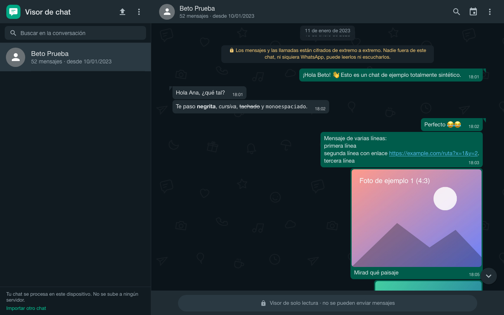
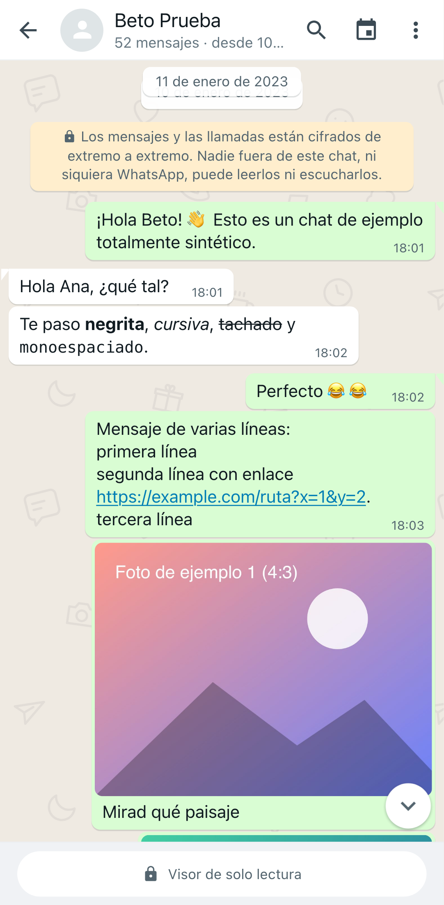
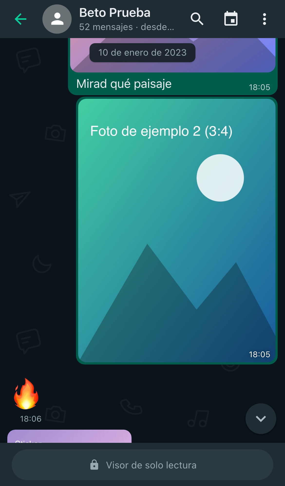

# Visor de chat

Lector local de exportaciones de chat de WhatsApp (`.txt` y `.zip`) que reconstruye la conversación con el aspecto de la aplicación: escritorio estilo WhatsApp Web y móvil a pantalla completa (estilos Android e iOS). Funciona **sin servidor, sin cuentas y sin conexión** (PWA instalable).

> Proyecto independiente: no está afiliado a WhatsApp/Meta, no se conecta a ninguna cuenta ni recupera mensajes que no estén en el archivo exportado. Es un visor de solo lectura. Ver [NOTICE.md](NOTICE.md).

| Escritorio (oscuro) | Móvil Android | Móvil iPhone |
|---|---|---|
|  |  |  |

## Comandos

Requisitos: Node ≥ 20 (probado con 22) y npm.

```bash
npm install                 # instala dependencias
npm run dev                 # servidor de desarrollo → http://localhost:5173
npm test                    # pruebas unitarias y de componentes (Vitest)
npm run build               # comprobación de tipos + compilación de producción en dist/
npm run preview             # sirve dist/ en http://localhost:4173 (con Service Worker)
npm run e2e:install         # una vez: descarga Chromium, WebKit y Firefox de Playwright
npm run test:e2e            # E2E (construye y sirve dist/; 5 proyectos de navegador/dispositivo)
npm run verify              # tipos + unitarias + build + E2E
npm run samples             # genera muestras sintéticas en samples/ (ZIP con multimedia, TXT; usa ffmpeg si existe)
npm run samples:big -- 100000   # genera chats sintéticos grandes en samples/generated/
npm run bench:parser        # mide el analizador (Node) con 10k/50k/100k/300k mensajes
npm run icons               # regenera los iconos PWA desde public/icons/icon.svg
npm run screenshots         # capturas de todos los estilos (necesita `npm run preview` activo)
```

### Despliegue

Es un sitio estático: sirve el contenido de `dist/` con cualquier hosting (Netlify, GitHub Pages, S3, nginx…), en la raíz o en una subruta (las rutas son relativas). Requisitos: HTTPS (o `localhost`) para el Service Worker y la instalación. Recomendado: `Cache-Control: no-cache` para `index.html` y `sw.js`. La CSP ya va en el HTML; si tu hosting permite cabeceras, puedes repetirla ahí.

## Uso

1. Exporta el chat desde WhatsApp (Android: ⋮ → Más → Exportar chat; iPhone: nombre del chat → Exportar chat) con o sin multimedia.
2. Arrastra el `.txt`/`.zip` o pulsa «Seleccionar archivo». Si el ZIP trae varios `.txt`, eliges cuál.
3. Indica quién eres (verás tus mensajes a la derecha; si no, vista neutral). Puedes cambiarlo en Datos o Ajustes.
4. Busca (`Ctrl/Cmd+F` o `/`), salta a una fecha, abre imágenes y vídeos a pantalla completa, consulta estadísticas o exporta una copia HTML.

## Qué hace

Importación TXT/ZIP con validación por contenido (no por extensión), progreso, cancelación y errores recuperables · parser robusto multi-región (Android/iOS, DMY/MDY/YMD, 12/24 h, dígitos árabes/indios, RTL, multilínea, avisos del sistema en 6 idiomas, llamadas, eliminados, omitidos, ubicaciones, contactos) · corrección del orden de fecha sin reabrir · lista virtualizada · búsqueda en todo el chat en un worker · imágenes, stickers, vídeo, notas de voz con forma de onda real, documentos con tarjeta, adjuntos faltantes con aviso · visor con navegación y «Atrás» coherente · tema claro/oscuro/sistema · estilos Web/Android/iOS · panel de datos y estadísticas · exportación HTML (solo texto o con adjuntos en ZIP) · persistencia local opcional con consentimiento · PWA offline con actualización controlada.

## Verificación realizada (resultados reales)

Ejecutado en macOS con Node 22, Chromium/WebKit/Firefox de Playwright (**emulación** de dispositivos; sin limitar CPU):

| Comprobación | Resultado |
|---|---|
| `tsc --noEmit` (strict, `noUncheckedIndexedAccess`) | sin errores |
| Vitest (parser, fechas, idiomas, ZIP, importador, MediaStore, filas, resaltado, formato, exportación, IndexedDB, componentes) | **153 pruebas, todas correctas** |
| `npm run build` | correcto; JS 600 kB (206 kB gzip) + worker 19 kB + CSS 47 kB (11 kB gzip) |
| Playwright E2E (Chromium escritorio y Android/Pixel 7, WebKit escritorio e iPhone 14, Firefox) | **155 correctas, 0 fallos** (2 ejecuciones seguidas), 61 omitidas por diseño (métricas solo en Chromium, atajos en táctiles…) |
| axe-core WCAG 2.1 A/AA (importación, chat, diálogos, panel de datos, visor; claro y oscuro) | sin violaciones |
| PWA: manifiesto/iconos reales, SW, caché solo del app shell, offline (importar, leer, buscar, visor), flujo de actualización, CSP sin violaciones | correcto en Chromium (offline); registro y caché también en WebKit |
| Privacidad: 0 peticiones fuera del origen, 0 POST, nada del chat en URL, `localStorage` solo `wv:prefs`, IndexedDB sin crear sin consentimiento | correcto |

**Rendimiento** (Chromium 1280×800, chats sintéticos; tiempos de esta máquina, no garantías):

| Mensajes | TXT | Hasta primer bloque legible | Filas en DOM | Heap JS tras importar | Búsqueda* | Salto a fecha | Ir al final | Scroll 3 s |
|---|---|---|---|---|---|---|---|---|
| 10 000 | 0,7 MB | 157 ms | 20 | +6 MB | 154 ms | 292 ms | 264 ms | 61 fps, 0 fotogramas >50 ms |
| 50 000 | 3,6 MB | 403 ms | 19 | +14 MB | 167 ms | 290 ms | 264 ms | 60 fps, 0 >50 ms |
| 100 000 | 7,3 MB | 844 ms | 20 | +26 MB | 167 ms | 311 ms | 256 ms | 61 fps, 0 >50 ms |

\* incluye 140 ms de antirrebote; el índice resuelve en ~6 ms con 100 000 mensajes (Node). Analizador en Node (`bench:parser`): 100 000 mensajes → 294 ms de análisis, 87 ms de índice; 300 000 → 867 ms. Abrir/cerrar el visor de imagen: 2–5 ms (10 repeticiones). **ZIP de 1,6 GB** (adjuntos de 1,2 GB y 0,4 GB): conversación abierta en 146 ms con 4 MB de heap JS (no se carga en memoria). Probado además con 300 000 solo en Node, no en navegador.

## Limitaciones conocidas (honestas)

- **Fidelidad visual**: reproduce de memoria los patrones de WhatsApp Web, Android e iOS (colores, radios, tipografías, colas, fondo vectorial propio). No se contrastó píxel a píxel con capturas oficiales (no disponibles) y WhatsApp cambia su diseño; todo está tokenizado en `src/styles/tokens.css` y `themes.css` para ajustarlo sin tocar componentes. Se aplican correcciones deliberadas de accesibilidad (texto secundario algo más oscuro para contraste AA, enlaces subrayados, botón verde con contraste suficiente).
- **Dispositivos reales**: no probado en un iPhone/Android físicos ni en la PWA ya instalada en modo standalone; Safari/iOS y Chrome/Android se verificaron con los motores WebKit/Chromium de Playwright y emulación táctil. El ajuste al teclado virtual de iOS (`visualViewport`) está implementado pero sin verificar en un dispositivo. Firefox no se probó offline con SW (limitación de la emulación).
- **Idiomas/fechas**: probados es-ES, es-MX, en-US/GB, de, fr, it, pt-BR/PT, nl, ja, zh (iOS), ar (dígitos y ص/م), ko (mejor esfuerzo). Calendarios persa e islámico no se convierten (el mensaje se conserva con su hora original y se avisa); budista sí. Avisos del sistema reconocidos en es/en/pt/fr/de/it; en otros idiomas aparecen como aviso genérico. No se afirma compatibilidad universal.
- **Memoria**: cada adjunto mostrado se descomprime completo en memoria (límite 1 GB por archivo; los pesados se cargan al tocarlos). Las descargas también pasan por memoria. Exportar «HTML + adjuntos» arma el ZIP en memoria (se rechaza por encima de 1,5 GB de adjuntos). TXT del chat: máximo 150 MB.
- **Formatos multimedia** dependen del navegador: HEIC solo en Safari; Opus/Ogg en algunos Safari; códecs de vídeo según plataforma (Chromium y Firefox de Playwright carecen de H.264). En esos casos se muestra una tarjeta con descarga, nunca una imagen rota. La forma de onda requiere poder decodificar el audio; si no, barra de progreso simple.
- El estado de lectura, entrega, edición y respuestas **no se muestran** porque no constan en la exportación.
- Pendiente (no implementado): recepción desde «Compartir» de Android (`share_target`), `file_handlers`, división del bundle (zip.js en chunk perezoso), pruebas de regresión visual por píxel.

## Estructura

Ver [docs/ARCHITECTURE.md](docs/ARCHITECTURE.md) (auditoría de los repositorios de referencia, capas y decisiones) y [NOTICE.md](NOTICE.md) (licencias y atribuciones).

## Licencia

MIT (ver [LICENSE](LICENSE)). Las ideas tomadas de Chat Viewer y ChatLume (ambos MIT) se detallan en NOTICE.md; no se ha copiado código.
